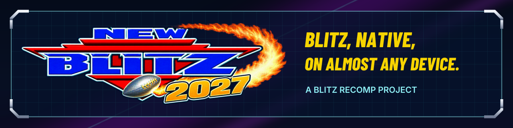

# New Blitz 2027



**NFL Blitz 2000, running natively on almost any device you own.** A Blitz Recomp project.

**[newblitz.com](https://newblitz.com)** · [Download](../../releases/latest) · [Discord](https://newblitz.com/discord) · [Contribute](https://newblitz.com/contribute)

New Blitz is the 1999 Nintendo 64 game, recompiled to run as a native app: no emulator. It plays the game as it was,
adds what a modern setup wants (widescreen, save states, Redo Play, phones as controllers, tournaments, a modern
season mode), and can bring the game up to date with a season pak.

- **Bring your own cartridge.** New Blitz needs your own dump of **NFL Blitz 2000 (USA) v1.1**. No game assets are
  included, and nobody here can send you one.
- **Free and non-commercial.** Not affiliated with, endorsed or sponsored by the NFL, the NFL Players Association,
  any NFL club, Midway or its successors.

## Get it

**Get New Blitz for your computer** from [Releases](../../releases/latest). It sets up your phone, handheld, PS5 or an
N64/emulator export too: the computer is the hub, and it sends each device the game with your ROM and your setup
already in, so the device starts ready to play. You supply your own NFL Blitz 2000 (USA) v1.1 cartridge dump: the
computer app asks for it.

| Computer | File | How | State |
|---|---|---|---|
| **Windows** (x64) | `NewBlitz-v<version>-Windows-Setup.exe` | Run it: installs for you alone (no administrator), adds New Blitz to Start | Tested |
| **Mac** (Apple Silicon) | `NewBlitz-v<version>-macOS.dmg` | Open it, drag New Blitz to Applications | Tested |
| **Linux** (x86_64) | `NewBlitz-v<version>-x86_64.AppImage` | `chmod +x` it, run it | Untested |

Then, from the computer app's **Blitz Builder** (Settings → General), pick where else to play:

| Device | Blitz Builder | State |
|---|---|---|
| **Android** phone or handheld | Phone or Handheld → Android: sent over USB ([docs/ANDROID.md](docs/ANDROID.md)) | Tested |
| **Dual-screen Android** | the same, on two-screen handhelds ([docs/BLITZ_DS.md](docs/BLITZ_DS.md)) | Beta |
| **iPhone / iPad** | Phone or Handheld → iPhone: saves the `.ipa` with your ROM inside, to install with [Sideloadly](https://sideloadly.io) ([docs/IOS_SIDELOAD.md](docs/IOS_SIDELOAD.md)) | Tested (a free Apple ID works) |
| **PS5** (jailbroken, etaHEN) | PS5: sent over your network ([docs/PS5_HOMEBREW.md](docs/PS5_HOMEBREW.md)) | Preview |
| **N64 or an emulator** | N64 or Emulator: writes a `.z64` | Tested |

How each device's send works: [Sending to your devices](#sending-to-your-devices).

### Advanced: install on a device by hand

No computer to set it up from? The release page also has `NewBlitz-v<version>-Android.apk` and
`NewBlitz-v<version>-iPhone.ipa`. Install it yourself, then pick your ROM on the device: the app's first screen says
how to set it up from a computer, with **Pick a File Instead** below (on an iPhone you can also share the ROM to New
Blitz from the Files app).

Rather unzip than install? Each release also has `-macOS-arm64.zip`, `-Windows-x64.zip` and `-Linux-x64.tar.gz` (the
app folder; the Linux one uses the system's SDL2, FreeType and Vulkan). RecompLauncher installs from those.

### Opening it the first time

The downloads aren't signed with a developer certificate, so your device asks first:

- **Windows:** on the SmartScreen prompt, **More info → Run anyway**. Settings → Apps uninstalls it; your saves stay.
- **Mac:** open the app once (it's blocked), then **System Settings → Privacy & Security → Open Anyway**.
- **Linux:** `chmod +x` the AppImage, then run it.
- **Android:** allow installs from your browser or file manager when it asks.
- **iPhone / iPad:** turn on **Settings → Privacy & Security → Developer Mode** if it asks.

## First run

1. **Where do you want to play?** This computer, a phone or handheld, a PS5, or an N64/emulator.
2. **Load ROM.** Pick your dump (`.z64`, `.v64`, `.n64`, or a `.zip` holding one). The app checks it's the right game
   and keeps a copy.
3. **Add the 2026 season?** One click downloads the 2026 Season pak (today's teams, rosters, uniforms and team art,
   about 2 MB) and plays **New Blitz** with it. Or choose **Just the 1999 game** to play the cartridge as it was
   (**Original 1999**). You can add or remove the pak later under **Add-Ons**.
4. **Recommended or Customize:** the recommended setup, or the Rules tab first to pick house rules.
5. **Updates and reports:** **Keep rosters and uniforms up to date** is ticked (untick it to stay offline); **Send
   crash reports** is off unless you tick it, and Settings → General shows exactly what a report contains.
6. **Play,** or the device's last step: the iPhone or Android file, the send to a PS5, or the `.z64` export.

The Builder runs again from **Settings → General → Blitz Builder** whenever you want another device or an export.
To start over, **Settings → General → Reset Data** clears the settings, saves and setup (it can keep your ROM and back
everything up first, to Documents → New Blitz Backups); **Restore a Backup** puts a backup back.

## Sending to your devices

The computer app is the hub. Its Builder carries the device builds and sends each one with your ROM and your setup,
so the device skips the ROM and setup questions and starts ready to play (it only asks about updates and crash
reports, once). Phones, handhelds and the PS5 have no Builder of their own. Each device needs its own way in:

- **PS5:** a jailbroken console running etaHEN, on the same network. Blitz Builder → PS5, enter the console's
  address; the Builder sends the game over FTP and starts it.
- **Android:** turn on USB debugging, connect the phone or handheld, and have
  [platform-tools](https://developer.android.com/tools/releases/platform-tools) (`adb`) installed. Blitz Builder →
  Phone or Handheld → Android → **Send over USB**. No `adb`? **Save the APK** saves the app with your ROM beside it:
  copy both over, install the APK, and pick the ROM with **Pick a File Instead**.
- **iPhone / iPad:** Apple only installs apps you sign yourself, so the Builder doesn't send this one. Blitz Builder
  → Phone or Handheld → iPhone → **Save the iPhone app (.ipa)** makes `NewBlitz.ipa` with your ROM and setup already
  inside (Downloads → New Blitz for iPhone, on a Mac, Windows or Linux). We recommend
  [Sideloadly](https://sideloadly.io), on a Mac or Windows:
  1. Install Sideloadly. On Windows it also needs Apple's iTunes and iCloud from apple.com (the web versions, not the
     Microsoft Store ones).
  2. Plug the iPhone in with a cable.
  3. Drag `NewBlitz.ipa` into Sideloadly and sign in with your own Apple ID. A free one works. You type the password
     into Sideloadly; it's never shared with New Blitz.
  4. Before you start, turn on **AutoRefresh**: the circular-arrows button to the left of Start.
  5. On the iPhone: Settings → General → VPN & Device Management → trust your Apple ID. Turn on Developer Mode if iOS
     asks.
  6. Turn on Wi-Fi sync for the phone. On a Mac: Finder → select the iPhone → "Show this iPhone when on Wi-Fi". On
     Windows: the same option in iTunes.
  7. Open New Blitz. It starts ready to play. (The release page's own `.ipa` has no ROM inside: it asks for one with
     **Pick a File Instead**, or share the ROM to New Blitz from the Files app.)

  A free Apple ID's install lasts 7 days. With AutoRefresh on, Sideloadly re-signs it in the background every
  few days whenever the computer is on and the phone is on the same Wi-Fi. Nothing to click, and your saves stay. If it
  ever lapses, the app won't open until it's refreshed: plug in and click Start again in Sideloadly. A paid Apple
  developer account lasts a year. A free account allows 3 sideloaded apps per device.

  Other options: [AltStore](https://altstore.io) with AltServer also refreshes over Wi-Fi from a computer.
  [SideStore](https://sidestore.io) refreshes on the phone itself, but setup is fiddlier. Step by step, and building it
  yourself with Xcode: [docs/IOS_SIDELOAD.md](docs/IOS_SIDELOAD.md).

## Paks

Paks are add-ons the Builder installs: season rosters, uniform sets, team art, announcer calls, rules. The 2026 Season
pak is the one-click download above. Community paks are shared on our [Discord](https://discord.gg/AtcKN9dY5). To make
one, or to bring New Blitz to another device, see the [contributor guide](https://newblitz.com/contribute).

## Community

- **Discord:** [discord.gg/AtcKN9dY5](https://discord.gg/AtcKN9dY5): help, paks, bugs and showcase.
- **YouTube:** [@BlitzRecomp](https://www.youtube.com/@BlitzRecomp): the trailer, a feature reel, and setup videos for
  [Mac](https://youtu.be/uc_qAcu2bHk) and [Windows](https://youtu.be/Lv3aSgbUPi0).
- **X:** [@blitzrecomp](https://x.com/blitzrecomp).
- **Bugs:** an issue here, with the zip from Settings → General → Save Logs.

## Playing

Gamepads work out of the box; so do phones, as controllers, by scanning a QR code (Settings → Players). On Windows,
choose **Allow access** when Windows asks to let New Blitz use your network.

| N64 | Gamepad | Keyboard |
|---|---|---|
| Stick | left stick | W A S D |
| A (pass / switch player) | South (A / Cross) | Space |
| B (jump / tackle) | West (X / Square) | Left Shift |
| Z (turbo) | left trigger | Q |
| C buttons (targeted passes) | right stick, North/East buttons | arrow keys |
| D-pad | D-pad | I J K L |
| Start | Start | Return |

Save states: F5 saves, F7 loads, F6 picks a slot. On a controller, hold the right stick pressed in (R3; L3 too on
one-stick handhelds) as the hotkey: + R1 saves, + L1 loads, + □ / ○ picks the slot. Redo Play runs the last play again: hotkey + △ (or D-pad up), or F8.
Fullscreen: F11, or L3 + R3. Screenshots: F12. More, including tournaments, phones as controllers and playing on a TV:
[docs/PLAYING.md](docs/PLAYING.md).

## How it's made

The game itself is NFL Blitz 2000's own code, translated from your cartridge by N64Recomp, a deterministic tool: no AI
writes or changes the game's logic. Everything around it (the menus, seasons, save states, the phone controllers, the
ports to iPhone, Android and PS5) was written with AI coding agents (Claude), directed, reviewed and play-tested by a
person on real hardware: Mac, Windows, iPhone, Android handhelds, PS5 and a real N64. That's 800+ commits, 700+ builds
and hundreds of hours of hands-on playtesting. AI helped ship it, but we don't think it's AI slop: if you love the
original Blitz, we think this is the best way to Blitz today.

Every release is checked by a test suite, a scan that keeps game data and private details out of the downloads, and
someone playing it. If something's broken, tell us in #bugs on the [Discord](https://discord.gg/AtcKN9dY5). What's new
in each version: [CHANGELOG.md](CHANGELOG.md).

## Building from source

The apps are built on a Mac (every platform cross-builds from it). You need your own dump for the build too: the
recompiler reads the game's code from it.

```
make env && make venv     # check the toolchain; the Python tools
tools/build_deps.sh       # SDL2 and FreeType for the Mac (once)
# put your NFL Blitz 2000 (USA) v1.1 dump in rom/
make rom-import           # check it and pin its SHA-1
make test                 # tool tests (synthetic data only)
make app-modern           # the Mac app
make all-platforms        # every platform set up here, with a pass/fail table
```

Per platform: [docs/PLATFORMS.md](docs/PLATFORMS.md). Contributing: [CONTRIBUTING.md](CONTRIBUTING.md).

## Credits and licences

New Blitz stands on N64Recomp and N64ModernRuntime (Wiseguy and contributors), RT64, the Zelda 64: Recompiled team's
frontend, Zoinkity's research and the NFL Blitz community: [CREDITS.md](CREDITS.md). The code is GPL-3.0
([LICENSE](LICENSE)); third-party licences are in [NOTICES.md](NOTICES.md).

NFL Blitz is a trademark of its owner. All names, logos and trademarks belong to their owners.
